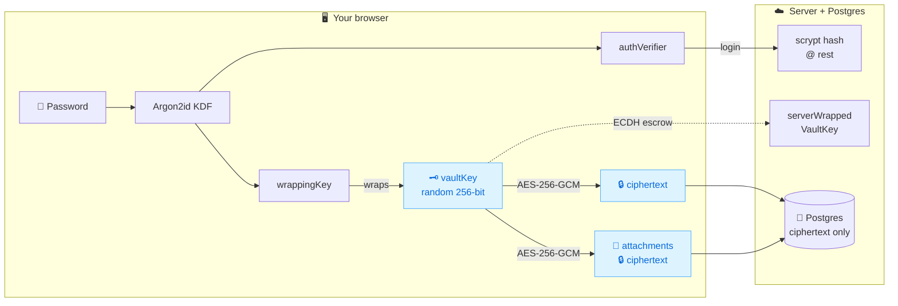
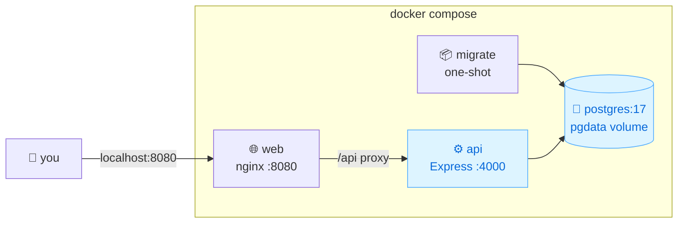

<div align="center">


# Vaultory

### Your secrets, encrypted before they leave your browser.

A personal password &amp; secrets manager where the server only ever stores ciphertext -
AES-256-GCM in the browser, Argon2id key derivation, zero plaintext at rest.

[](LICENSE)
[](https://nodejs.org)
[](frontend)
[](backend)
[](backend/tsconfig.json)
[](docker-compose.yml)
[](#-scripts--testing)

**[Features](#-features) · [How it works](#-how-it-works) · [Quick start](#-quick-start) · [Docker](#-docker-self-hosted) · [Docs](#-documentation) · [Security model](docs/security.md)**

</div>

---

<div align="center">

## 🔐 How it works

**The server never sees your password or your plaintext - ever.**

</div>



- Password derives **two independent outputs**: `authVerifier` goes to the server (stored as a scrypt hash), `wrappingKey` **never leaves the device** - it unwraps your random vault key.
- Every secret payload and file attachment is AES-256-GCM ciphertext (`v1.<nonce>.<data>`) before it touches the network.
- Honest trade-off, documented in [docs/security.md](docs/security.md): a server-side escrow copy exists **only** so password reset can recover your vault instead of destroying it.

---

<div align="center">

## ✨ Features

<table>
<tr>
<td width="33%">

### 🛡️ Security

- 🔐 AES-256-GCM + Argon2id vault
- 📧 Email verification (link + OTP)
- ⏱️ 10-min single-use reset links
- 🔢 Account TOTP (RFC-6238)
- 🪪 Passkey unlock (WebAuthn PRF)
- 🚫 Disposable-mail blocklist
- 🍯 Signup honeypot + rate limits

</td>
<td width="33%">

### 🗄️ Vault

- 🗂️ 18 secret categories
- 📎 Encrypted file attachments
- 📁 Nested folders (3 levels)
- 🗑️ 30-day trash & restore
- 🕓 Version history + restore
- 🔍 Search, tags, favorites
- 📋 List / grid views

</td>
<td width="33%">

### 🚀 Power tools

- ⌘ Command palette (`Ctrl+K`)
- 🤝 E2E secret sharing (ECDH)
- 🆘 Emergency access w/ wait
- 📊 Security dashboard + map
- 📶 Wi-Fi join QR codes
- 🌐 HaveIBeenPwned k-anonymity
- 📦 CSV/`.env` import + encrypted backup

</td>
</tr>
</table>

<sub>+ login favicons · drag-&-drop attachments · duplicates & rotation alerts · health audit · installable PWA · MV3 browser extension · light/dark themes · fully responsive</sub>

</div>

---

<div align="center">

## 🧱 Tech stack

</div>

<div align="center">

| Layer        | Tech                                                                            |
| ------------ | ------------------------------------------------------------------------------- |
| **Frontend** | React 19 · Vite · Tailwind v4 · TanStack Query · Radix UI · React Hook Form     |
| **Backend**  | Express 5 · TypeScript · Zod · Prisma 7 · Pino · Helmet                         |
| **Crypto**   | Argon2id (`@noble/hashes`) · Web Crypto AES-256-GCM · ECDH P-256 · WebAuthn PRF |
| **Data**     | PostgreSQL (Neon-ready) · Prisma migrations · IndexedDB key persistence         |
| **Ships as** | Docker compose · Vercel serverless · PWA · MV3 extension                        |

</div>

---

<div align="center">

## 🚀 Quick start

</div>

Requirements: Node.js 20+, npm, a PostgreSQL database (Neon free tier works).

```bash
# 1. Backend
cd backend
cp .env.example .env          # fill DATABASE_URL / DIRECT_URL / SESSION_SECRET
npm install                   # runs prisma generate (postinstall)
npx prisma migrate deploy     # create the schema
npm run dev                   # http://localhost:4000

# 2. Frontend (second terminal)
cd frontend
npm install
npm run dev                   # http://localhost:5173 (/api proxied to :4000)
```

Create an account at `http://localhost:5173/signup`. Your password never leaves the browser.

---

<div align="center">

## 🐳 Docker (self-hosted)

**One command - Postgres + migrations + API + web:**

</div>

```bash
cp .env.docker.example .env   # set SESSION_SECRET / VAULT_WRAP_SECRET / POSTGRES_PASSWORD
docker compose up -d --build
```

Then open **http://localhost:8080**



- `migrate` applies the schema before `api` starts (`service_completed_successfully`)
- Data persists in the `pgdata` volume - `down` keeps it, `down -v` wipes it
- Generate secrets: `openssl rand -base64 48` · enable email: `EMAIL_TRANSPORT=smtp` + `SMTP_*`

---

<div align="center">

## ☁️ Deployment (Vercel + Neon)

</div>

Two Vercel projects from this repo - full walkthrough in [docs/deployment.md](docs/deployment.md):

1. **API project** - root `backend/`. `api/index.ts` is the serverless entrypoint; `vercel.json` rewrites all traffic to it.
2. **Web project** - root `frontend/`. `vercel.json` rewrites `/api/*` to the API (same-origin cookies) and everything else to `index.html`.

Rate limits on credential endpoints are **database-backed**, so they hold across serverless cold starts.

---

<div align="center">

## 🗂 Repository layout

</div>

```
backend/          Express 5 + Prisma 7 API, migrations, tests, serverless entrypoint
backend/api/      Vercel serverless handler (api/index.ts)
frontend/         React 19 + Vite + Tailwind v4 app, PWA config, e2e suite
extension/        MV3 browser extension (vault list, copy, autofill)
docs/             security.md · deployment.md
docker-compose.yml  Self-hosted stack (db + migrate + api + web/nginx)
```

---

<div align="center">

## ⚙️ Environment variables

</div>

<details>
<summary><strong>backend/.env</strong> - click to expand</summary>

| Variable                              | Required    | Purpose                                                                              |
| ------------------------------------- | ----------- | ------------------------------------------------------------------------------------ |
| `DATABASE_URL`                        | yes         | Pooled Postgres connection (Neon: `-pooler` host)                                    |
| `DIRECT_URL`                          | migrations  | Non-pooled connection for `prisma migrate`                                           |
| `SESSION_SECRET`                      | yes         | ≥32 chars; HMAC key for session/reset tokens at rest                                 |
| `VAULT_WRAP_SECRET`                   | yes         | ≥32 chars; server escrow keypair for reset recovery - rotating orphans escrowed keys |
| `SESSION_TTL_DAYS`                    | no          | Session lifetime (default 30)                                                        |
| `AUTO_LOCK_MINUTES`                   | no          | Default inactivity auto-lock for new accounts (0 = never, max 480)                   |
| `CORS_ORIGINS`                        | no          | Comma-separated allowed browser origins                                              |
| `CROSS_SITE_COOKIES`                  | no          | `true` when frontend+API are different sites (`SameSite=None;Secure`)                |
| `TRUST_PROXY`                         | no          | Set behind proxies/load balancers so client IPs are honored                          |
| `APP_URL`                             | no          | Frontend URL used in email links                                                     |
| `REQUIRE_EMAIL_VERIFICATION`          | no          | Gate vault features behind verified email (default on)                               |
| `EMAIL_TRANSPORT`                     | no          | `console` (dev), `resend`, or `smtp`                                                 |
| `EMAIL_FROM`                          | no          | Sender identity, e.g. `Vaultory <no-reply@yourdomain.com>`                           |
| `RESEND_API_KEY`                      | with resend | Resend delivery                                                                      |
| `SMTP_HOST`/`SMTP_PORT`/`SMTP_SECURE` | with smtp   | Relay host, port (465 SSL / 587 STARTTLS)                                            |
| `SMTP_USER`/`SMTP_PASS`               | with smtp   | SMTP login - Gmail needs an **app password**                                         |

</details>

<details>
<summary><strong>frontend/.env</strong> - click to expand</summary>

| Variable            | Required | Purpose                                              |
| ------------------- | -------- | ---------------------------------------------------- |
| `VITE_API_BASE_URL` | no       | Defaults to `/api`. Set only for a cross-origin API. |

</details>

---

<div align="center">

## 🧪 Scripts & testing

| Where    | Command                                | What it does                                               |
| -------- | -------------------------------------- | ---------------------------------------------------------- |
| backend  | `npm run dev` / `start`                | dev server (`tsx watch`, `.env` reloads) / compiled server |
| backend  | `npm test`                             | Vitest + Supertest API & crypto suites (62 tests)          |
| backend  | `npm run typecheck` / `lint` / `build` | strict TS / ESLint / tsc build                             |
| frontend | `npm test`                             | Vitest crypto, importer & audit suites                     |
| frontend | `npm run e2e`                          | Playwright browser journeys (TOTP login, trash, dashboard) |
| frontend | `npm run build`                        | production build                                           |

</div>

---

<div align="center">

## 📚 Documentation

| Doc                                          | Covers                                                                                     |
| -------------------------------------------- | ------------------------------------------------------------------------------------------ |
| [docs/security.md](docs/security.md)         | Encryption architecture, session/transport security, abuse resistance, honest known limits |
| [docs/deployment.md](docs/deployment.md)     | Docker self-host + Vercel/Neon walkthrough, migrations on release                          |
| [extension/README.md](extension/README.md)   | Browser extension install & autofill                                                       |
| [CONTRIBUTING.md](CONTRIBUTING.md)           | Dev setup, ground rules, pre-PR checklist                                                  |
| `docker-compose.yml` + `.env.docker.example` | Self-hosted Docker stack                                                                   |

</div>

---

<div align="center">

## 👤 Author


**Deepak**

[](https://github.com/phoenixdev100)

## 📄 License

MIT - see [LICENSE](LICENSE). Use it, fork it, self-host it.

<sub>Built with ❤️ - your secrets stay yours.</sub>

</div>
